# Heart Disease Risk Prediction: An End-to-End MLOps Pipeline

**Course:** Machine Learning Operations (AIMLCZG523), Assignment 1

**Student:** Darshil Sanjay Shah

**BITS ID:** `2025AE05573`

**Code repository:** <https://github.com/i-am-darshil/heart-disease-mlops>

**Container image:** ghcr.io/i-am-darshil/heart-disease-api (public, on GitHub Container Registry)

**Demo video:** <https://drive.google.com/file/d/1TddmiH2vmCuL6Y0h5w_gZtIYoA3dKroN/view?usp=sharing>

---

## 1. Summary

I built a heart disease classifier on the UCI Cleveland dataset, then put the whole MLOps lifecycle around it: from raw data to a monitored API running on Kubernetes. Every step is automated, runs in a pinned Docker environment, and can be repeated from a clean machine with one command.

| Area | What I built | Result |
|---|---|---|
| Data & EDA | Checksum-verified download, validation, cleaning, 5 EDA figures | 303 patients, 6 missing values (imputed inside the model), 46% positive |
| Modelling | 4 candidates (dummy, logistic regression, random forest, gradient boosting), grid search, 5-fold CV | Logistic regression (L1, C = 1.0): **CV ROC-AUC 0.907 ± 0.011** |
| Decision policy | Threshold lowered from 0.5 to **0.249** so that CV recall is at least 90% | Held-out test: **recall 1.000**, ROC-AUC 0.959, accuracy 0.836 |
| Experiment tracking | MLflow: one parent run per training, a child run per model and grid point, Model Registry with a `@champion` alias | 54 runs per training; 6 registered versions |
| Packaging | `model.joblib` (the full preprocessing + model pipeline) and `model_metadata.json` (version, hashes, schema, metrics, drift baseline) | Two training runs produce byte-identical model files |
| CI/CD | GitHub Actions, 8 jobs, all running inside the same Docker image as local development | ~4.5 min per push; 83 tests pass, 90% coverage |
| Serving | FastAPI with input validation, explanations and Prometheus metrics, in a slim non-root image | `/predict` p95 latency 42 ms under load |
| Deployment | k3s + Helm on a Rocky Linux 9 VM. Exposed by a LoadBalancer (:8080) and a Traefik Ingress (:80). Pull-based auto-deploy with automatic rollback | Two replicas, zero-downtime rolling updates |
| Monitoring | Structured JSON request logs, Prometheus (8 tested alert rules), a provisioned Grafana dashboard, **data-drift detection** | Drift alert fires on shifted traffic within ~6 minutes |

---

## 2. Architecture

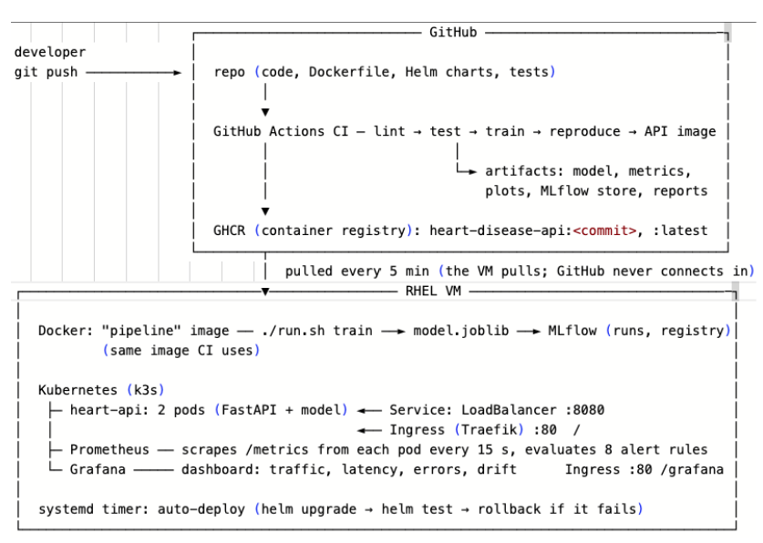

*Figure 1: System architecture*

The system has three parts. A single commit links them all together:

1. **Build (GitHub).** A push to `main` starts the CI workflow. It lints, tests, trains, checks reproducibility, and builds a serving image **with the freshly trained model inside**. The image is published to GHCR as `heart-disease-api:<commit>` and `:latest`.
2. **Train and track (the VM, in Docker).** `./run.sh` runs every pipeline step inside a `pipeline` Docker image (Python 3.10.22 and pinned libraries). CI uses the same image. Training logs to MLflow (a SQLite backend plus an artifact store) and registers the selected model.
3. **Serve and observe (the VM, on Kubernetes).** k3s runs two API pods behind a LoadBalancer Service and an Ingress. Prometheus scrapes each pod's `/metrics` and Grafana visualises them. A systemd timer checks GHCR every 5 minutes and deploys new images.

**Traceability.** Each step records the same commit hash:

> commit `d2b6c64` → CI run #12 → model artifact `model-d2b6c64…` → image `heart-disease-api:d2b6c646845c` → Helm revision → the running pod (`/model` and `heart_model_info{model_version=…}` report it)

So for any prediction, I can find the exact code, data hash and CI run that produced the model behind it.

### Technology choices

| Layer | Choice | Why |
|---|---|---|
| Runtime | Docker (`pipeline`, `notebooks` and `serve` targets in one Dockerfile) | The target VM (Rocky Linux 9) has a different Python from my laptop; Docker makes "works on my machine" true everywhere |
| ML | scikit-learn 1.7.2 `Pipeline` + `ColumnTransformer` | Preprocessing is fitted on training folds only and ships inside the model |
| Tracking | MLflow 3.17 (SQLite + local artifacts) | Runs, plots and a model registry with no server to maintain |
| API | FastAPI + Pydantic | Validation from type hints, and auto-generated OpenAPI docs at `/docs` |
| CI | GitHub Actions + GHCR | Free cloud runners, and the registry lives next to the code |
| Orchestration | k3s (a lightweight Kubernetes) + Helm 4 | Real Kubernetes in one ~70 MB binary; includes a LoadBalancer (ServiceLB) and an Ingress (Traefik) |
| Monitoring | Prometheus 3.13 + Grafana 13 (my own Helm chart) | Pull-based scraping with Kubernetes service discovery; dashboards stored as code |

---

## 3. Setup and Installation

The pipeline was developed on macOS and tested on a **Rocky Linux 9.5 VM** (x86_64, 16 GB RAM, SELinux enforcing). Copy-paste didn't work on the VM, so every step is a short `./run.sh <command>`.

**Prerequisites:** a RHEL-family Linux host (or any machine with Docker), `git`, internet access, and `sudo` for the one-time Kubernetes setup.

```bash
# 1. One-time: installs git + Docker, adds the user to the docker group, clones the repo
curl -fsSL https://raw.githubusercontent.com/i-am-darshil/heart-disease-mlops/main/scripts/vm-bootstrap.sh | bash
cd ~/heart-disease-mlops

# 2. The whole ML pipeline in Docker: build the image, lint, test, train (logs to MLflow)
./run.sh all
./run.sh mlflow            # MLflow UI on http://127.0.0.1:5050
./run.sh predict           # predict for examples/sample_request.json

# 3. The API as a container (built locally, or pulled from GHCR)
./run.sh serve-build && ./run.sh serve && ./run.sh api-test

# 4. Kubernetes: install k3s + Helm (one time), deploy the newest CI image, verify
./run.sh k8s-setup
./run.sh deploy
./run.sh k8s-test          # helm test + requests through the Ingress and the LoadBalancer
./run.sh autodeploy-on     # deploy new CI images automatically

# 5. Monitoring
./run.sh monitoring        # Prometheus + Grafana
./run.sh load drift 600    # synthetic traffic: normal | drift | errors
```

`./run.sh help` (Figure 2) lists every command. Without Docker, `make setup && make test && make train` does the same with a local virtual environment (`requirements.txt` for the pipeline, `requirements-dev.txt` for tools, `requirements-serve.txt` for the API image).

**Accessing the deployment (local cluster, not public):**

| What | URL |
|---|---|
| API (Ingress) | `http://<vm-ip>/` (Swagger docs at `/docs`) |
| API (LoadBalancer) | `http://<vm-ip>:8080/` |
| Grafana | `http://<vm-ip>/grafana` (anonymous view; admin password from `./run.sh monitoring-status`) |
| Prometheus | `http://<vm-ip>/prometheus` |
| MLflow | `http://127.0.0.1:5050` on the VM, or through `ssh -N -L 5050:127.0.0.1:5050 <user>@<vm>` |

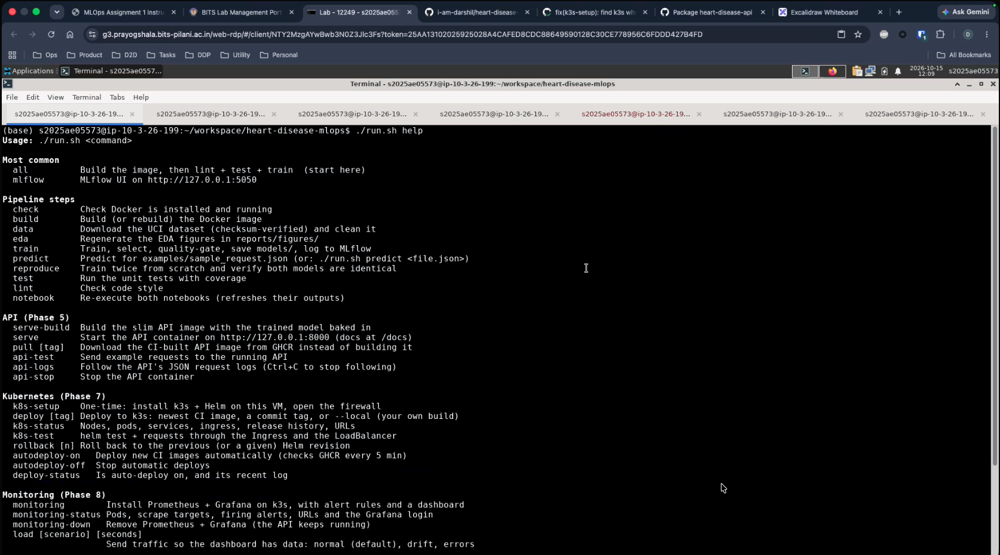

*Figure 2: Every operation is one `./run.sh` command, grouped by phase.*

---

## 4. Data Acquisition and Exploratory Data Analysis

### 4.1 Acquisition and cleaning

`scripts/download_data.py` downloads `processed.cleveland.data` from the UCI repository and **checks its SHA-256** against a pinned value. If the upstream file ever changes, the script fails instead of silently training on different data. `src/heart/data.py` then:

- parses the headerless file with the 14 UCI column names, treating `?` as missing;
- drops duplicate rows, and rows with values outside clinical ranges (e.g. age 1–120, cholesterol 50–700) or unknown category codes. None were found, but the check protects later retrains;
- binarises the target: `num` 0 → no disease, 1–4 → disease;
- **keeps missing values as NaN** (`ca`: 4, `thal`: 2). Imputation is done inside the model pipeline, so its statistics come from training folds only, and the API handles a missing field the same way.

The cleaned file (`data/processed/heart.csv`, 303 rows × 14 columns) is committed, so CI never depends on the UCI site being up.

### 4.2 Findings

| Figure | Observation | Effect on modelling |
|---|---|---|
| Class balance (Fig. 3) | 164 no disease (54%), 139 disease (46%) | Roughly balanced: no resampling, but stratified splits and folds |
| Numeric distributions (Fig. 5) | Patients with disease reach a lower max heart rate (mean 139 vs 158) and have higher ST depression (1.6 vs 0.6). Cholesterol and blood pressure barely separate the classes | `thalach` and `oldpeak` matter more than `chol` |
| Disease rate by category (Fig. 6) | Asymptomatic chest pain: 73% disease rate (vs 18–30% for other types). Reversible thallium defect: 76% (vs 22% normal). 0 vessels coloured: 26%, rising to 85% for 3. Exercise angina: 77% vs 31% | Coded features carry the most signal, so they are one-hot encoded instead of treated as numbers |
| Correlation heatmap (Fig. 4) | Strongest with the target: `thal` 0.53, `ca` 0.46, `exang` 0.43, `oldpeak` 0.42, `thalach` −0.42. No feature pair is above 0.6 | No severe collinearity; a regularised linear model is a reasonable candidate |

<table><tr>
<td>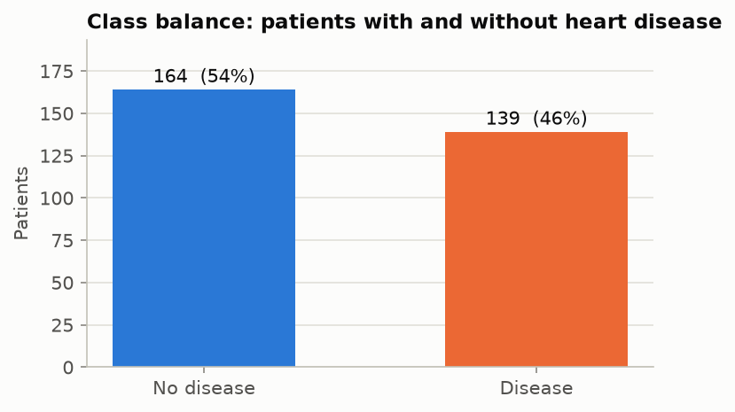<br><em>Figure 3: Class balance.</em></td>
<td>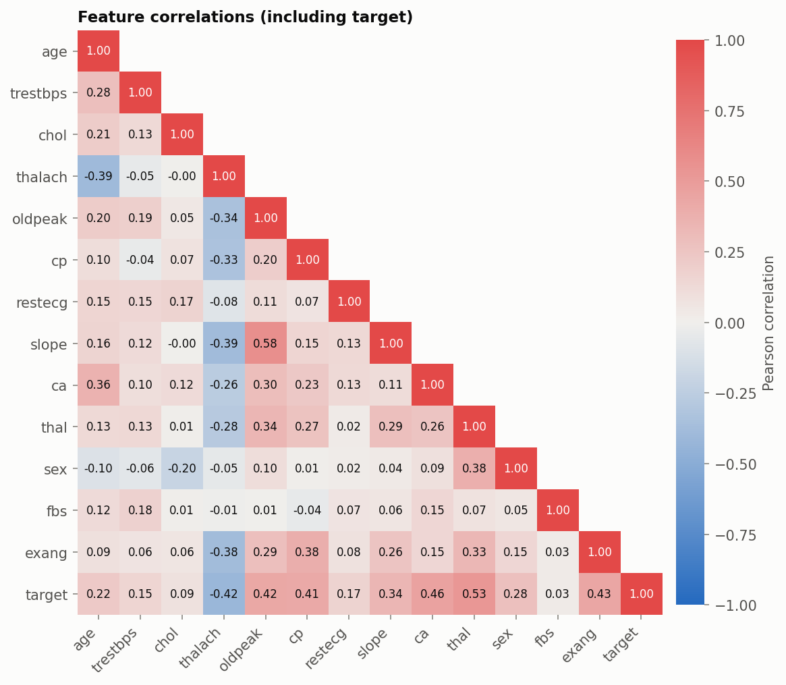<br><em>Figure 4: Feature correlations, including the target.</em></td>
</tr></table>

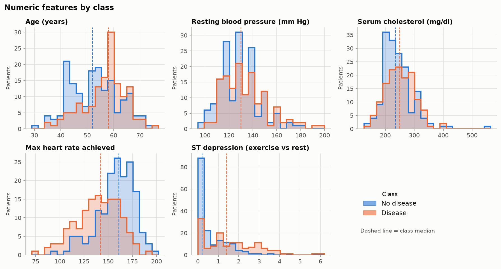

*Figure 5: Numeric features by class. Dashed lines are the class medians.*

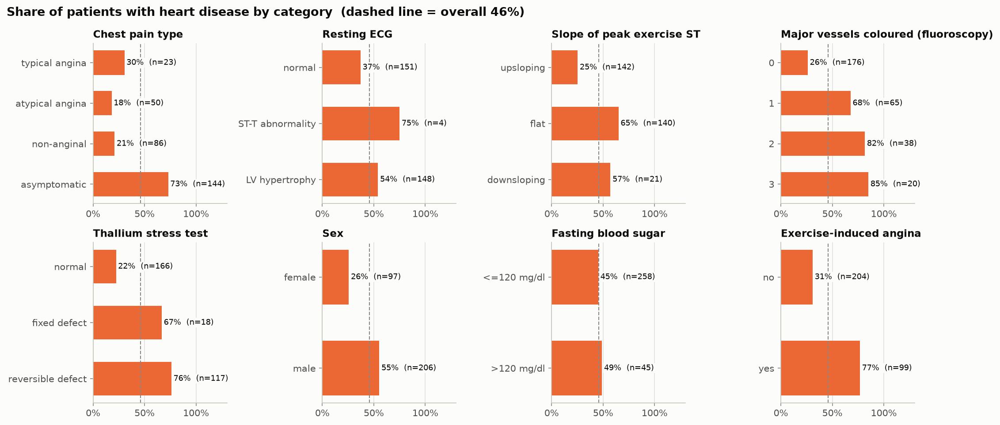

*Figure 6: Disease rate for each level of each categorical feature.*

The analysis is in `notebooks/01_eda.ipynb`. The figures are produced by `src/heart/eda.py` (`./run.sh eda`), so the notebook and the pipeline always show the same plots.

---

## 5. Feature Engineering and Model Development

### 5.1 Features

The features are built by one `ColumnTransformer` (`src/heart/features.py`) that is the first step of every model pipeline:

| Group | Columns | Transformation |
|---|---|---|
| Numeric | age, trestbps, chol, thalach, oldpeak | Median imputation → standardisation |
| Categorical | cp, restecg, slope, ca, thal | Most-frequent imputation → one-hot encoding, with **categories fixed from the UCI codebook** |
| Binary | sex, fbs, exang | Most-frequent imputation |

Fixing the categories matters on a small dataset: `restecg = 1` occurs only 4 times, so some CV folds would otherwise lack the column and break.

### 5.2 Training and selection procedure (`src/heart/train.py`)

1. **Stratified 80/20 split** (242 training, 61 test). The test set is used exactly once, at the end.
2. **Grid search with stratified 5-fold CV** for each candidate, refitting on ROC-AUC and recording accuracy, precision, recall and F1 too:

| Candidate | Grid (points) | Best parameters |
|---|---|---|
| Dummy (stratified random) | (1) | Baseline: every real model must beat it |
| Logistic regression (elastic-net, saga) | C ∈ {0.01 … 10}, l1_ratio ∈ {0, 1} (14) | C = 1.0, l1_ratio = 1.0 (pure L1) |
| Random forest (300 trees) | max_depth, min_samples_leaf, max_features (18) | max_depth 4, sqrt features |
| Gradient boosting | n_estimators, learning_rate, max_depth, subsample (16) | 100 trees, lr 0.03, depth 2 |

3. **Selection with the one-standard-error rule.** The candidates are ordered simplest first; I pick the first one whose CV ROC-AUC is within one standard error of the best. With 242 training rows, a model that is better by less than its own noise isn't reliably better. Here logistic regression also had the best mean, so the rule and the raw ranking agree.

| Model (5-fold CV) | ROC-AUC | Accuracy | Precision | Recall | F1 |
|---|---|---|---|---|---|
| dummy | 0.515 ± 0.077 | 0.525 | 0.478 | 0.396 | 0.433 |
| **logistic_regression** | **0.907 ± 0.011** | 0.835 | 0.854 | 0.783 | 0.812 |
| random_forest | 0.901 ± 0.022 | 0.826 | 0.836 | 0.783 | 0.803 |
| gradient_boosting | 0.884 ± 0.030 | 0.818 | 0.846 | 0.756 | 0.792 |

4. **Threshold tuning for screening.** For a screening tool, missing a sick patient (a false negative) costs far more than a false alarm. I lowered the decision threshold from 0.5 until the **out-of-fold** recall reached 90%. That threshold is **0.249** (Fig. 9). It is stored in a `FixedThresholdClassifier`, so `model.predict()` applies it automatically and the API and the CLI can't disagree.
5. **Quality gate.** Training exits with a non-zero code if CV ROC-AUC is below 0.85 or the model doesn't beat the dummy. This is what makes CI fail on a bad model (Section 8).

### 5.3 Held-out test results (61 patients)

| Threshold | Accuracy | Precision | Recall | F1 | ROC-AUC |
|---|---|---|---|---|---|
| **0.249 (deployed)** | 0.836 | 0.737 | **1.000** | 0.848 | 0.959 |
| 0.5 (default) | 0.869 | 0.833 | 0.893 | 0.862 | 0.959 |

At the tuned threshold the model catches all 28 sick patients in the test set, at the cost of 10 false alarms out of 33 healthy patients (Fig. 8). At 0.5 it would have missed 3. This trade-off was deliberate: a positive result from a screening model leads to further tests, not a diagnosis.

<table><tr>
<td>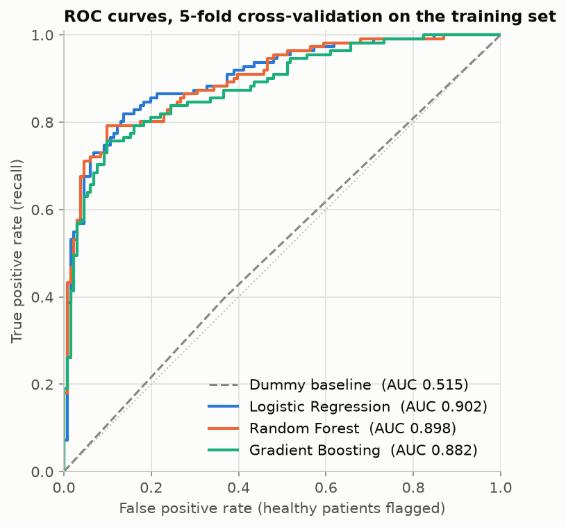<br><em>Figure 7: Out-of-fold ROC curves for all candidates.</em></td>
<td>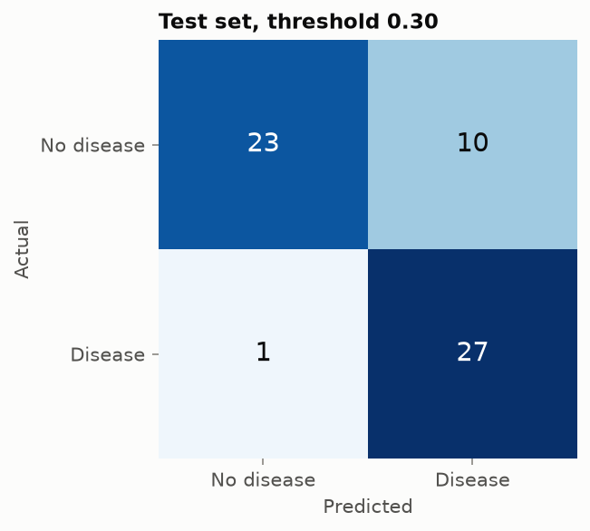<br><em>Figure 8: Test-set confusion matrix at threshold 0.25.</em></td>
</tr></table>

<table><tr>
<td>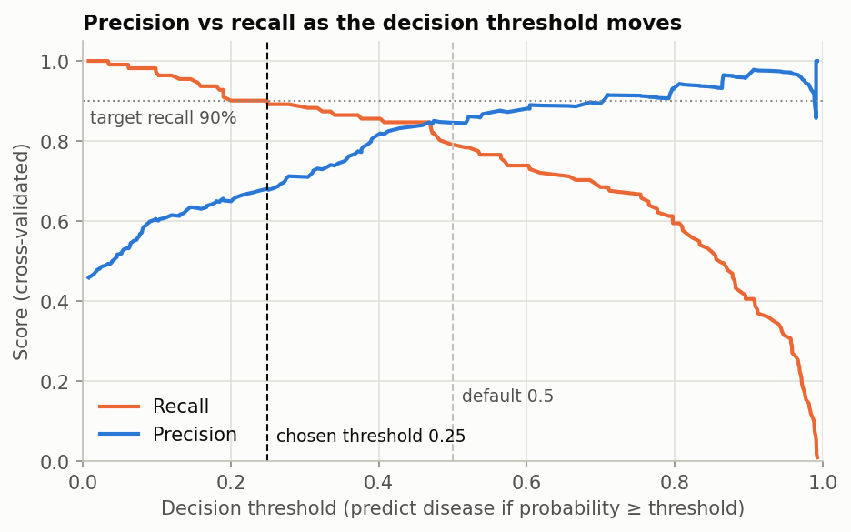<br><em>Figure 9: CV precision and recall against the threshold.</em></td>
<td>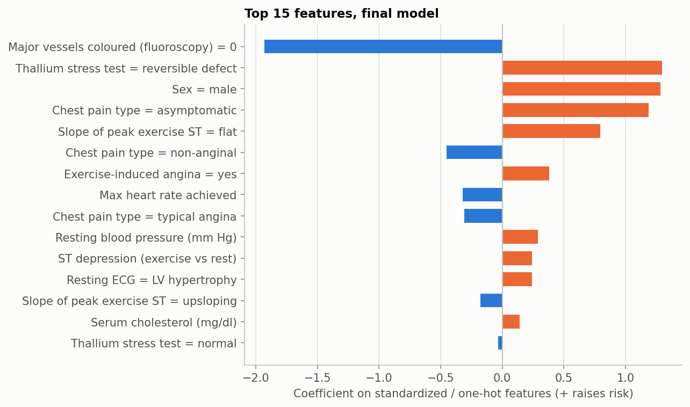<br><em>Figure 10: Coefficients of the final model.</em></td>
</tr></table>

**Interpretability.** The L1 penalty sets weak coefficients to zero. The strongest effects (Fig. 10) match the EDA and clinical intuition. No coloured vessels is strongly protective; a reversible thallium defect, male sex and asymptomatic chest pain raise risk. The API uses these coefficients to return the **top three factors** behind each prediction.

---

## 6. Experiment Tracking (MLflow)

`src/heart/tracking.py` logs every training to the `heart-disease` experiment. Each run is organised as a tree:

- **Parent run** `train:<model>`:
  - parameters: selected model, hyperparameters, threshold, target recall, split sizes and seeds;
  - metrics: CV and test metrics;
  - tags: git commit, raw-data SHA-256, quality-gate result;
  - artifacts: the comparison table, `metrics.json` and all four plots;
  - the training dataset, logged as an MLflow input with its digest.
- **One child run per candidate**, with its best parameters, CV mean ± std, the full grid-search CSV and its ROC curve.
- **One grandchild run per grid point** (49 in total), so any hyperparameter can be compared in MLflow's chart view.
- **The model**, logged with an inferred signature and an input example, and registered as `heart-disease-classifier`. The `@champion` alias moves to the new version **only if the quality gate passed**.

A training therefore creates 54 runs. Six trainings during development gave the 324 runs in Figure 11. The tracking store is a single SQLite file plus an artifact folder. That's enough for one person, and setting `MLFLOW_TRACKING_URI` switches to a shared server with no code change. In CI, the store of every run is uploaded as an artifact (`mlflow-<commit>`), so even a failed CI training can be opened with `mlflow ui`.

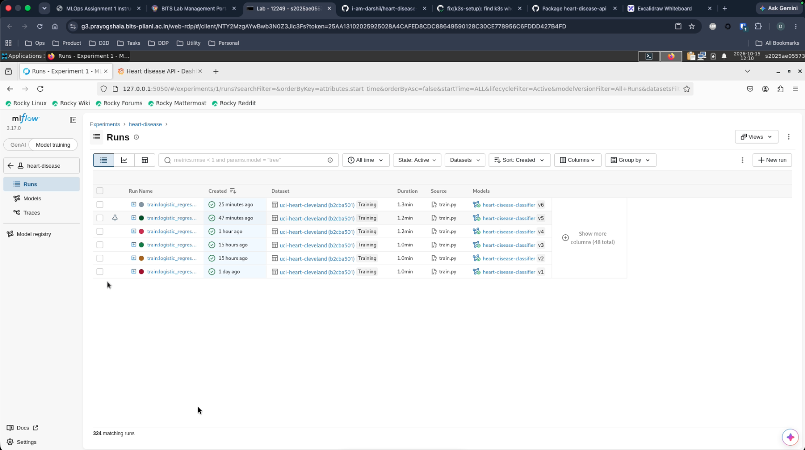

*Figure 11: MLflow runs. Each training is a parent run linked to its registered model version.*

<table><tr>
<td>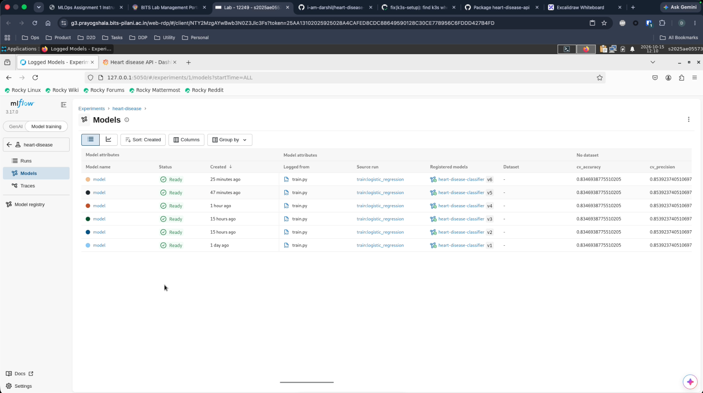<br><em>Figure 12: Logged models with their CV metrics.</em></td>
<td>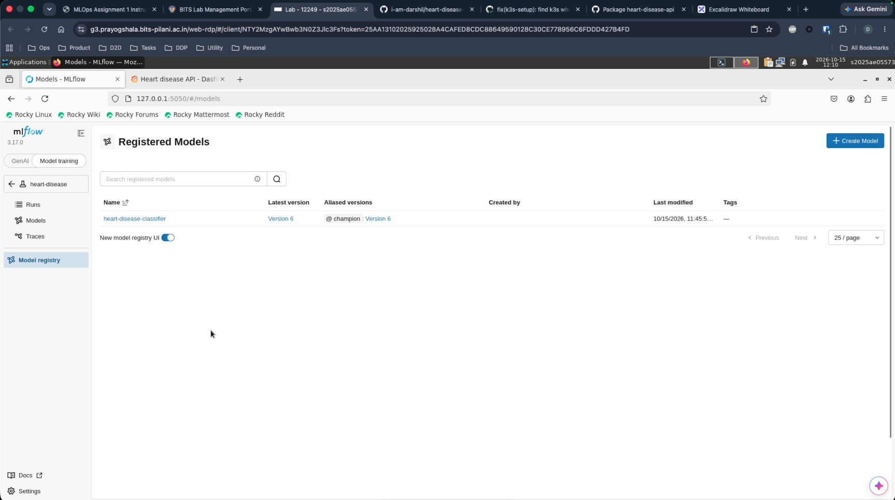<br><em>Figure 13: The registry: version 6 holds the <code>@champion</code> alias.</em></td>
</tr></table>

The CV metrics are identical across all six versions (Fig. 12, cv_accuracy 0.83469…). The training is deterministic; this was the first sign that the reproducibility work in Section 7 paid off.

---

## 7. Model Packaging and Reproducibility

### 7.1 What ships

| File | Contents |
|---|---|
| `models/model.joblib` | The whole fitted `FixedThresholdClassifier(Pipeline[ColumnTransformer → LogisticRegression])`. Raw patient JSON goes in; no separate preprocessing code is needed |
| `models/model_metadata.json` | Model version (= commit), creation time, model SHA-256, data hashes, estimator and parameters, threshold, metrics, **input schema** (types, ranges, allowed codes), library versions, and the **training baseline for drift monitoring** (positive rate, and mean and std of each numeric feature) |
| MLflow model | The same pipeline in MLflow format, with signature, in the registry |

`src/heart/packaging.py` checks the model's SHA-256 on load, and `src/heart/predict.py` provides a CLI (`./run.sh predict`) that uses the same `Predictor` class as the API.

### 7.2 Making it reproducible

- **Pinned environment.** Python 3.10.22 in the Docker base image, with every library pinned in `requirements*.txt`. A test checks that the serving requirements are a consistent subset of the training ones.
- **Pinned data.** The raw file's SHA-256 is checked on download, and the processed file's hash is recorded in the metadata.
- **Pinned randomness.** `RANDOM_STATE = 42` is used for the split, the CV folds and every estimator.
- **Proof, not a promise.** `python -m heart.reproduce` (`./run.sh reproduce`, and the `reproduce` CI job) trains twice from scratch in separate temporary folders. It passes only if:
  - the model files are **byte-identical** (same SHA-256);
  - predictions on all 303 rows are identical;
  - the metrics, the selected model and the threshold are identical.

  CI runs this on every push (Fig. 15).

---

## 8. CI/CD Pipeline and Automated Testing

### 8.1 Tests

There are 85 pytest tests in `tests/`, covering every module. In CI, 83 pass and 2 are skipped by design: they need the Helm binary, which the CI image doesn't include, and the `helm-lint` job runs those checks instead. Line coverage is **90%**.

| Area | Examples of what is tested |
|---|---|
| Data | Raw parsing, `?` → NaN, duplicates and out-of-range rows dropped, missing values kept for imputation, target binarisation, committed dataset matches the schema |
| Features | Output width, standardisation, unseen categories ignored, imputation uses training statistics only |
| Training | The one-SE rule picks the simpler model, the threshold reaches the target recall, the quality gate fails a weak model, the model beats the dummy |
| Tracking | Runs, child runs, artifacts and the registry alias, using a temporary MLflow store |
| Packaging | Metadata contents, drift baseline present, a tampered model file or mismatched library versions rejected on load, CLI predictions |
| API | `/predict` and `/predict/batch`, a 422 on bad input, missing fields imputed, `/ready` returns 503 without a model, metrics exposed |
| Kubernetes / monitoring | Generated manifests match the chart, the dashboard JSON matches its generator, every metric used by an alert is actually exported |

### 8.2 The workflow (`.github/workflows/ci.yml`)

```
Build CI image ──► lint ───────────────┐
workflow-lint, helm-lint ──────────────┴─► test ──┬─► train ──► API image ──► GHCR
                                                  └─► reproduce
```

| Job | What it does | Run #12 |
|---|---|---|
| **Build CI image** | Builds the same `pipeline` image as `./run.sh` and pushes it to GHCR, tagged by a hash of the dependency files (unchanged dependencies are a cache hit). **Every later job runs inside it** | 27 s |
| **lint** | `ruff check` (annotates offending lines in pull requests) and `ruff format --check` | 22 s |
| **workflow-lint** | `actionlint` on the workflow file itself | 11 s |
| **helm-lint** | `helm lint --strict` on both charts, `kubeconform` against the Kubernetes 1.36 schema, `promtool` tests for the alert rules | 25 s |
| **test** | pytest with coverage. Uploads `test-reports` (JUnit, log, coverage) **even when tests fail** | 57 s |
| **train** | `python -m heart.train`; the **quality gate can fail the run here**. Uploads `model-<sha>` and `mlflow-<sha>` | 1 m 17 s |
| **reproduce** | Trains twice and compares (Section 7.2) | 1 m 22 s |
| **API image** | Downloads the `model-<sha>` artifact, builds the `serve` image, starts it and smoke-tests it: `/health`, `/predict`, a 422 on bad input, `/metrics`, and that it runs as non-root. On `main` only, pushes `:<sha12>` and `:latest` to GHCR | 1 m 20 s |

The whole run takes **4 min 36 s** (Fig. 14). Each job writes a summary to the run page: test counts and coverage, the model comparison and test metrics, the reproducibility verdict, and the `docker pull` command for the published image (Figs. 15–16).

**How the pipeline fails.** Three mechanisms make failures stop the pipeline with clear logs:

1. Every job depends on the previous ones through `needs:`, so a red job skips everything after it, and a broken model can never be published.
2. Every `run:` step uses `bash -eo pipefail`, so `pytest | tee log` can't hide a failing test behind `tee`'s exit code.
3. Training returns a non-zero exit code when the quality gate fails.

A pull request that raises `MIN_CV_ROC_AUC` to 0.99 demonstrates this. The `test` job fails on the quality-gate assertion, and `train`, `reproduce` and `API image` never run. Pull requests run every check but never push images.

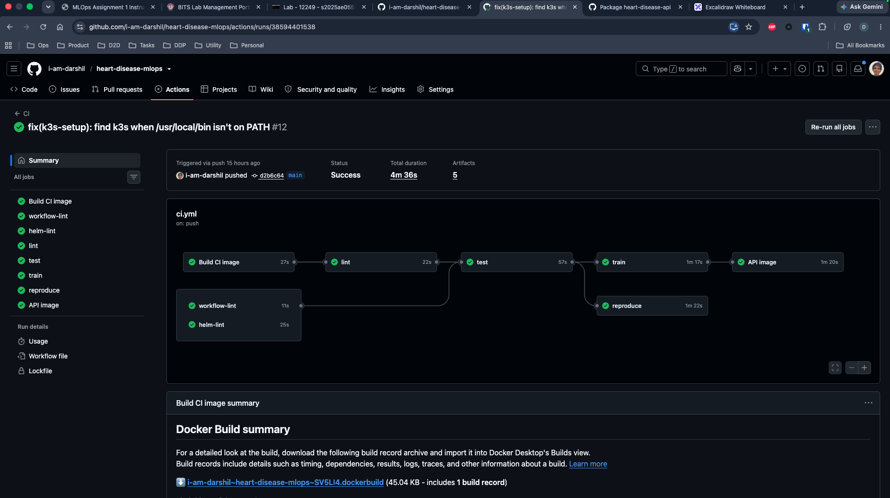

*Figure 14: CI run #12: the job graph, all green, 4 m 36 s, 5 artifacts.*

<table><tr>
<td>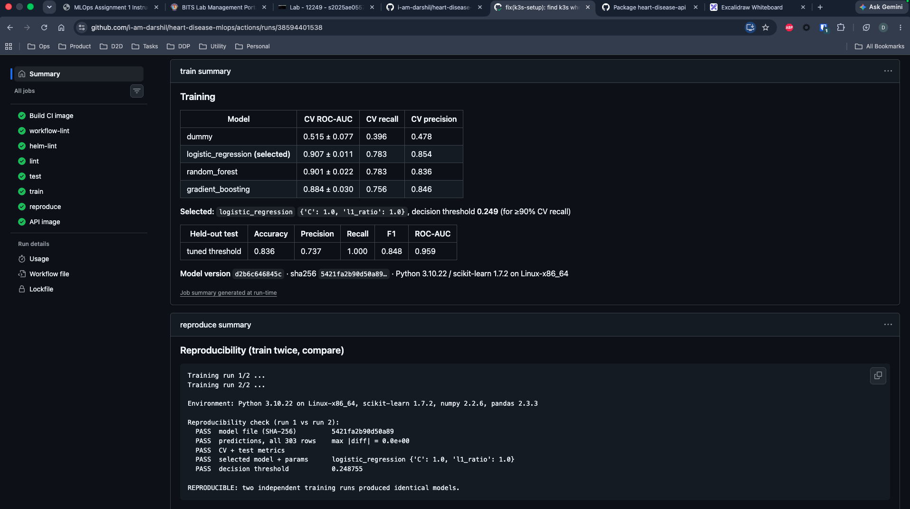<br><em>Figure 15: Training and reproducibility summaries written by CI.</em></td>
<td>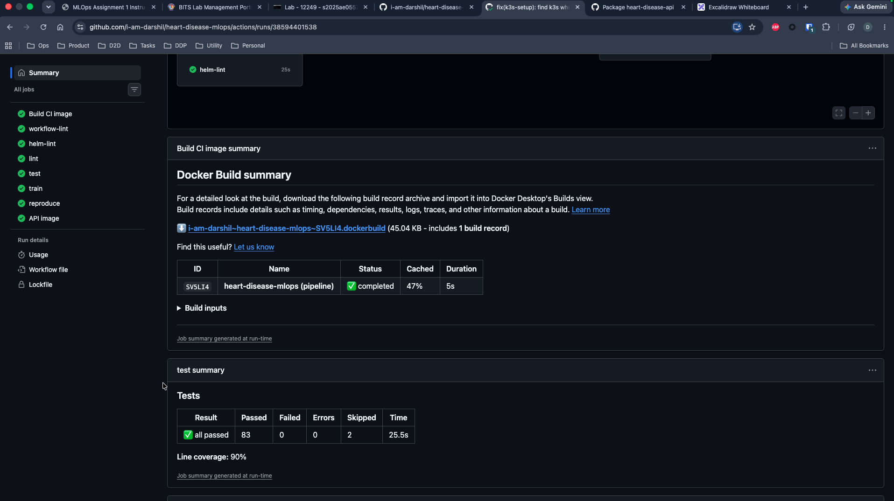<br><em>Figure 16: Test summary: 83 passed, 0 failed, 90% coverage.</em></td>
</tr></table>

**Artifacts kept for every run:**

| Artifact | Contents | Used for |
|---|---|---|
| `model-<sha>` | `model.joblib`, `model_metadata.json`, `metrics.json`, plots | Baked into the API image by the next job |
| `mlflow-<sha>` | `mlflow.db` + `mlartifacts/` | The full experiment record of the CI run |
| `test-reports` | `junit.xml`, `pytest.txt`, `coverage.xml` | Test evidence, kept even on failure |
| 2 × `.dockerbuild` | BuildKit build records | Build timing and cache analysis |

---

## 9. Model Containerisation

The `serve` target of the Dockerfile is a **multi-stage build**:

- a builder stage installs only `requirements-serve.txt` (FastAPI, uvicorn, scikit-learn and the Prometheus client; no MLflow, Jupyter or matplotlib) into a virtual environment;
- the runtime stage copies just that venv and the model.

The result:

- **The model is baked into the image**, so the image tag identifies exactly which model is served, and a container needs nothing mounted to start.
- **It runs as an unprivileged user** (uid 10001). In Kubernetes it also has a read-only root filesystem and drops all Linux capabilities.
- **One uvicorn worker per container.** Prometheus counters live in process memory, so I scale with pods instead of workers.
- It has a `HEALTHCHECK` on `/ready`, and `exec` makes uvicorn PID 1 so it shuts down gracefully on SIGTERM.

**API endpoints:**

| Endpoint | Purpose |
|---|---|
| `POST /predict` | One patient as JSON → prediction, label, probability, **confidence**, threshold, top 3 factors, model version |
| `POST /predict/batch` | Up to 1,000 patients |
| `GET /health` · `GET /ready` | Liveness (is the process alive?) · readiness (is the model loaded? 503 if not) |
| `GET /model` | Metadata of the served model |
| `GET /metrics` | Prometheus metrics |
| `GET /docs` | Interactive Swagger UI |

Validation comes from the metadata schema: out-of-range values, unknown codes and unknown fields return **422** with a clear message per field. A missing field is allowed and imputed, just as in training. Example:

```bash
$ curl -s -X POST http://<vm-ip>/predict -H 'Content-Type: application/json' \
       -d @examples/sample_request.json
{"prediction": 1, "label": "heart disease", "probability": 0.9787, "confidence": 0.9787,
 "threshold": 0.2488, "top_factors": [...], "model_version": "d2b6c646845c"}
```

The container is built and tested locally (`./run.sh serve-build && ./run.sh serve && ./run.sh api-test`) and again in CI on every push (the smoke test in Section 8.2), which proves it serves correctly in isolation.

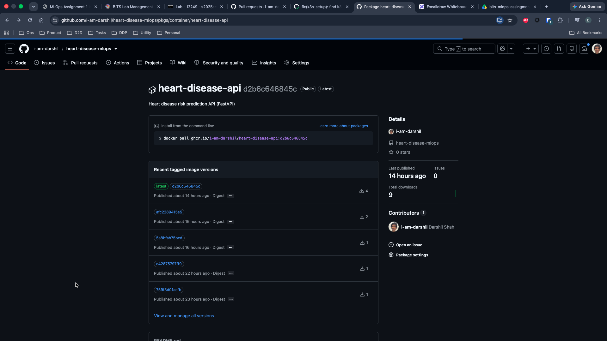

*Figure 17: The published image on GHCR: one tag per commit, plus `latest`.*

---

## 10. Production Deployment (Kubernetes)

### 10.1 Cluster and chart

`./run.sh k8s-setup` installs **k3s v1.36.5** and **Helm v4.3.0** on the VM (Fig. 18). It:

- opens the firewall for the pod and service networks and for ports 80, 8080 and 6443;
- installs the k3s SELinux policy;
- waits for the node and Traefik to be ready.

The API is deployed with my Helm chart `helm/heart-api`. For clusters without Helm, plain manifests generated from the chart are in `k8s/heart-api.yaml`.

| Kubernetes object | Configuration |
|---|---|
| Deployment | 2 replicas; rolling update with `maxUnavailable: 0, maxSurge: 1` (zero downtime); startup, readiness (`/ready`) and liveness (`/health`) probes; 100m CPU / 256Mi requests and a 512Mi memory limit; non-root, read-only filesystem |
| Service | **LoadBalancer** on port 8080 (k3s ServiceLB). Port 80 is taken by Traefik |
| Ingress | **Traefik**, path `/`, any host, so `http://<vm-ip>/` works without DNS |
| PodDisruptionBudget | At least 1 pod during node drains |
| HorizontalPodAutoscaler | Optional (`autoscaling.enabled`), 2–5 pods at 70% CPU |
| Helm test | A pod that calls `/predict` inside the cluster after every deploy |

### 10.2 Continuous deployment: the VM pulls

The GitHub cloud runners can't reach a VM on a private network, and I didn't want to store cluster credentials in GitHub. So deployment is **pull-based**:

- `./run.sh autodeploy-on` installs a systemd timer that runs `scripts/deploy.sh --if-changed` every 5 minutes.
- The script works out which commit `:latest` points to. If it differs from what's running, it runs `helm upgrade`, then `helm test`.
- **If the test fails, it rolls back to the previous revision automatically.**

`./run.sh deploy` runs the same script by hand. Figure 19 shows it in action:

- it resolves `latest -> d2b6c646845c`, the same tag CI published in Figure 17;
- it rolls the pods out, and the in-cluster test gets `OK d2b6c646845c heart disease 0.9787`;
- it reports `SUCCESS`.

Each Helm revision records its image tag, so `./run.sh rollback [n]` can return to any earlier model.

Endpoints are verified by `./run.sh k8s-test`. It runs `helm test`, then sends real requests through both the Ingress (port 80) and the LoadBalancer (port 8080). Deleting a pod by hand shows Kubernetes replacing it while the other replica keeps serving.

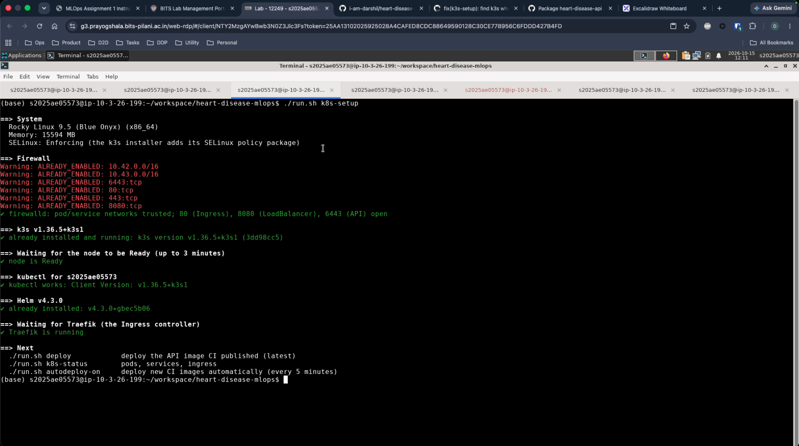

*Figure 18: `./run.sh k8s-setup` on Rocky Linux 9.5: firewall, k3s, node Ready, Helm, Traefik.*

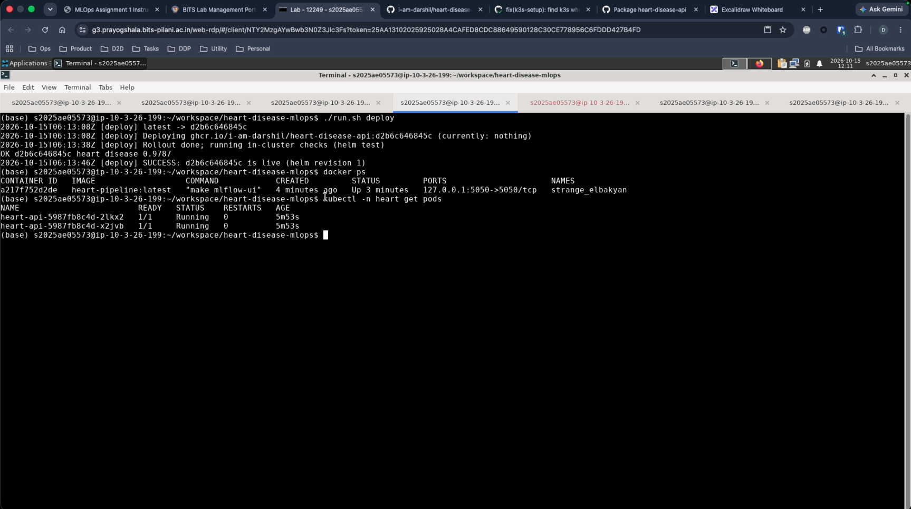

*Figure 19: `./run.sh deploy` pulls the CI image, rolls it out, passes the in-cluster test; 2 pods running.*

---

## 11. Monitoring and Logging

### 11.1 Request logging

Every request produces one **JSON log line** on stdout. It contains the timestamp, a request ID (also returned in the `X-Request-ID` header), method, path, status, duration, prediction, probability and model version. **Patient measurements are never logged.** The logs can be read with `kubectl logs -l app.kubernetes.io/name=heart-api` and are ready for any log stack (Loki, ELK) to collect.

### 11.2 Metrics

The API exposes standard HTTP metrics (requests, latency histograms, process CPU and memory) **plus model-specific ones**:

| Metric | Type | Answers |
|---|---|---|
| `heart_predictions_total{label}` | Counter | How many patients were flagged? |
| `heart_prediction_probability` | Histogram | Is the probability distribution changing? |
| `heart_inference_seconds` | Histogram | How long does the model itself take, apart from HTTP overhead? |
| `heart_validation_errors_total{endpoint}` | Counter | Are clients sending bad data? |
| `heart_missing_features_total{feature}` | Counter | Which inputs arrive missing (and get imputed)? |
| `heart_input_feature{feature}` | Summary | The live mean of each numeric input |
| `heart_reference_*` | Gauge | The **training baseline**, read from the model package |
| `heart_model_info{model_version,estimator}` | Gauge | Which model each pod is serving |

### 11.3 Prometheus, alerting and drift

`helm/monitoring` is my own chart, so I control every setting:

- **Scraping.** Prometheus finds the API pods through Kubernetes service discovery. Pods opt in with the `prometheus.io/scrape` annotation, so a new replica is scraped with no configuration change. It scrapes every 15 s, and its data is kept on a 2 Gi persistent volume for 7 days.
- **Recording rules** precompute request rates, error ratios, p95 latency, the live positive rate, and the **shift of each feature's live mean from its training mean, in training standard deviations**.
- **8 alert rules**, each unit-tested with `promtool` in CI:

| Alert | Fires when |
|---|---|
| HeartApiDown / HeartApiTargetDown | No pod is up for 1 m / one pod is down for 2 m |
| HeartModelNotLoaded | A pod runs without a model for 1 m |
| HeartApiServerErrors | More than 5% of requests are 5xx, for 5 m |
| HeartApiInvalidInputSpike | More than 20% of requests are invalid, for 2 m |
| HeartApiSlowPredictions | p95 `/predict` latency above 0.5 s, for 5 m |
| **HeartPredictionDrift** | The share flagged differs from training (60.7%) by more than 0.2, over 100+ predictions, for 5 m |
| **HeartInputDrift** | A feature's mean shifts more than 0.5 SD from training, over 100+ inputs, for 5 m |

Because the baseline ships with the model, the drift check updates automatically after every retrain. The 100-observation minimum stops a handful of unusual patients from firing it.

### 11.4 Grafana and load testing

Grafana's datasource and dashboard are **provisioned from code**: a Python script (`scripts/make_dashboard.py`) generates the dashboard JSON, and a test fails if the two drift apart. Its four rows (Fig. 20) are:

1. **Overview:** pods serving, model loaded, requests/s, 5xx rate, p95 latency, firing alerts.
2. **Traffic and errors:** requests by endpoint and status; latency p50, p95, p99 and model-only time.
3. **Model behaviour:** share flagged, live vs training; input drift in SDs; probability distribution; missing inputs.
4. **Pods:** memory, CPU, and the model version each pod serves.

`scripts/load_test.py` (`./run.sh load`) sends realistic synthetic traffic. It samples real patients with ±5% jitter, drops a field in 5% of requests and sends batches 10% of the time. It has three scenarios:

- `normal` (Fig. 22: 10 requests/s for 300 s, all HTTP 200);
- `errors`: 30% invalid requests. The invalid-input alert fired, then cleared once traffic returned to normal;
- `drift`: patients 15 years older, cholesterol +80 and max heart rate −30. In testing, 9,000 requests at 15/s had p50 21 ms and p95 42 ms. **HeartInputDrift fired for age (1.6 SD), cholesterol (1.4 SD) and max heart rate (1.3 SD)**, and the flagged share rose from 0.61 to 0.70.

The whole stack is light: an API pod uses about 135 MiB, Grafana about 130 MiB and Prometheus about 50 MiB.

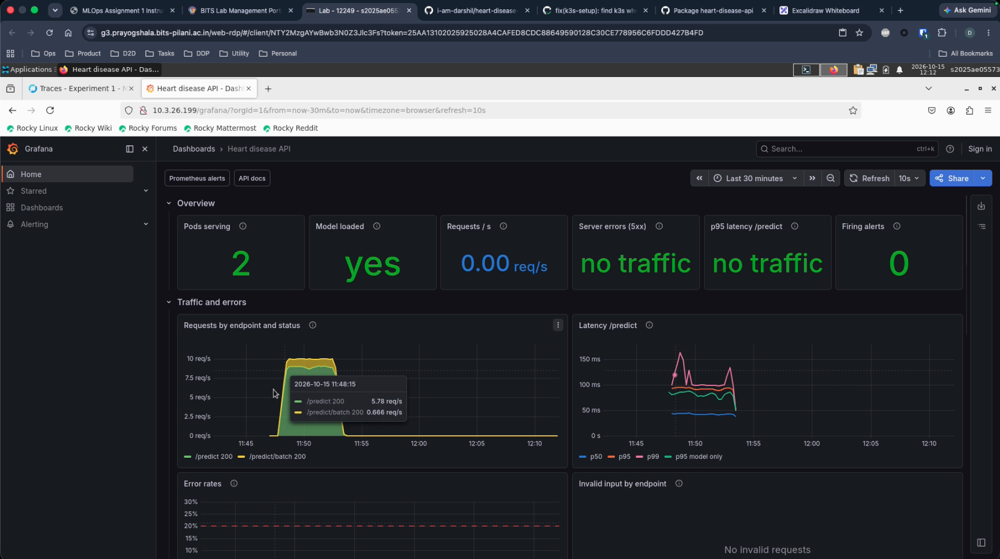

*Figure 20: The Grafana dashboard after a load test: 2 pods, model loaded, traffic and latency per endpoint.*

<table><tr>
<td>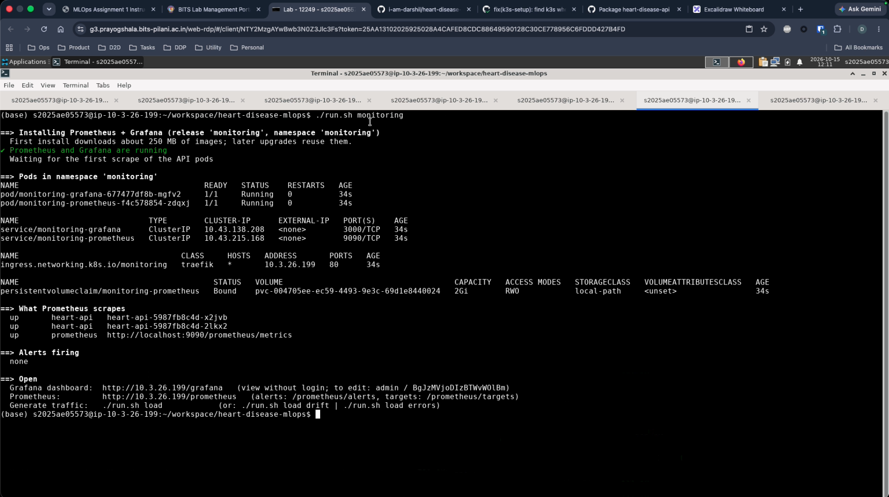<br><em>Figure 21: <code>./run.sh monitoring</code>: Prometheus finds both API pods (<code>up</code>); no alerts firing.</em></td>
<td>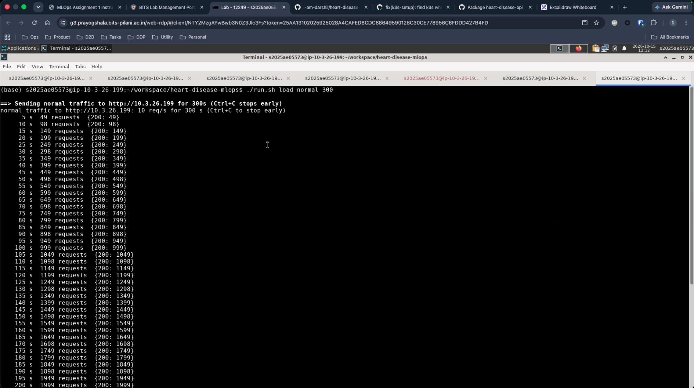<br><em>Figure 22: <code>./run.sh load normal 300</code>: 10 requests/s, all 200 OK.</em></td>
</tr></table>

---

## 12. Design Decisions

These choices reflect my own approach to the brief:

1. **Recall-first decision policy.** I tuned the threshold to the clinical cost of a missed case instead of keeping 0.5. I also used the one-SE rule, so I don't ship a more complex model on noise from 242 rows.
2. **One environment everywhere.** The same Docker image runs the pipeline on my Mac, on the RHEL VM and in every CI job. Bugs from Python-version and OS differences were removed instead of worked around.
3. **Reproducibility is tested, not assumed.** A CI job proves that two trainings give byte-identical models.
4. **The image is the unit of release.** It contains the model and is tagged with the commit, so "what's in production" is a single tag, and rollback is a Helm revision.
5. **Pull-based CD.** GitHub never connects to the VM and no credentials are stored, but deploys are still automatic, tested, and rolled back on failure.
6. **ML-aware monitoring.** As well as uptime and latency, the dashboard and alerts watch the model's inputs and outputs against a baseline saved at training time, so data drift is visible before accuracy can be measured.
7. **Everything is code and is tested.** Charts, alert rules, the dashboard and generated manifests are all validated in CI.

---

## 13. Deliverables Checklist

| Requirement | Where |
|---|---|
| Code, Dockerfile, requirements | `src/heart/`, `Dockerfile`, `requirements*.txt`, `pyproject.toml` |
| Cleaned dataset + download script | `data/processed/heart.csv`, `scripts/download_data.py`, `./run.sh data` |
| Notebooks / scripts (EDA, training, inference) | `notebooks/01_eda.ipynb`, `notebooks/02_modelling.ipynb`, `src/heart/train.py`, `src/heart/predict.py` |
| Unit tests | `tests/` (85 tests, 90% coverage) |
| CI workflow | `.github/workflows/ci.yml` |
| Deployment manifests / Helm charts | `helm/heart-api/`, `helm/monitoring/`, `k8s/heart-api.yaml` |
| Screenshots | `screenshots/` |
| Access instructions | Section 3 |
| Video | [Google Drive](https://drive.google.com/file/d/1TddmiH2vmCuL6Y0h5w_gZtIYoA3dKroN/view?usp=sharing) |

---

## Appendix A: Additional Screenshots

<table><tr>
<td>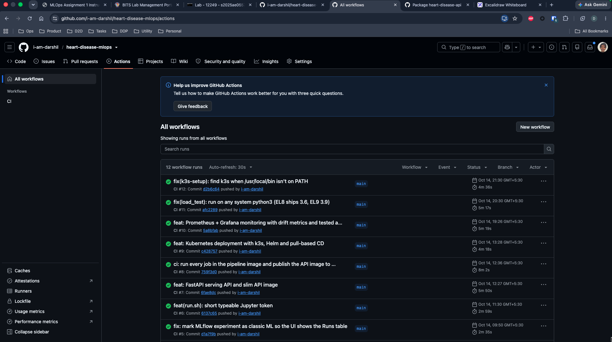<br><em>Figure A1: CI history: every push to <code>main</code> is green.</em></td>
<td>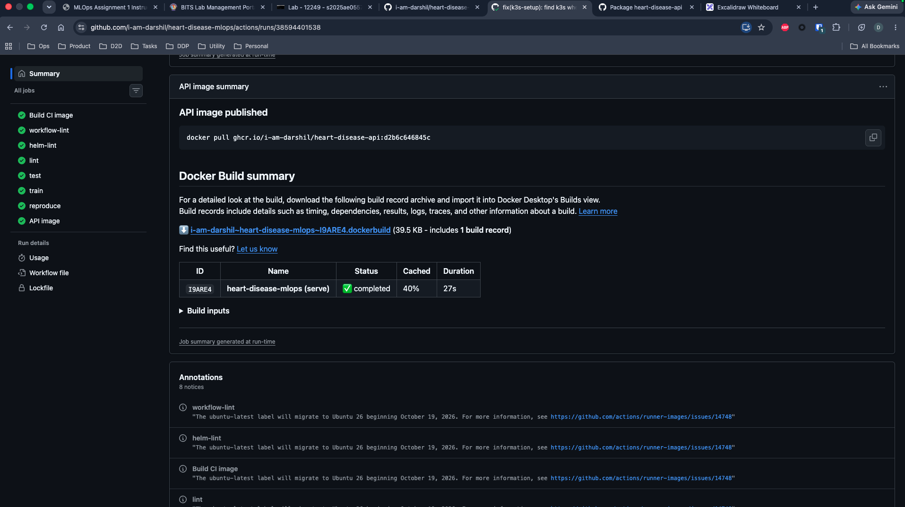<br><em>Figure A2: The API image job summary, with the exact <code>docker pull</code> command.</em></td>
</tr><tr>
<td>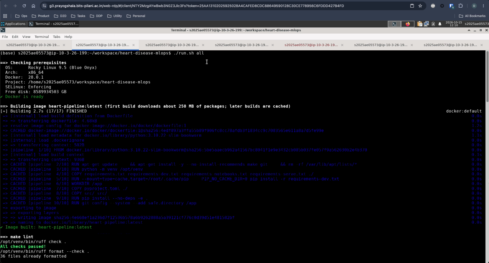<br><em>Figure A3: <code>./run.sh all</code> on the VM: environment check, image build (cached), lint.</em></td>
<td>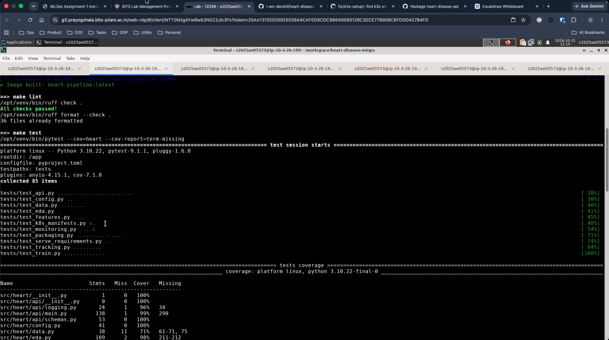<br><em>Figure A4: Lint and unit tests with coverage, inside Docker on the VM.</em></td>
</tr><tr>
<td>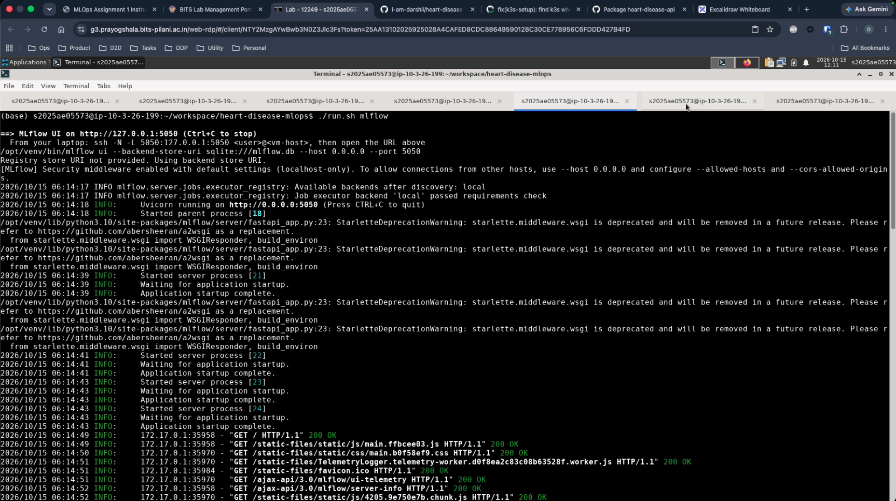<br><em>Figure A5: <code>./run.sh mlflow</code> serving the tracking UI on the VM.</em></td>
<td></td>
</tr></table>
